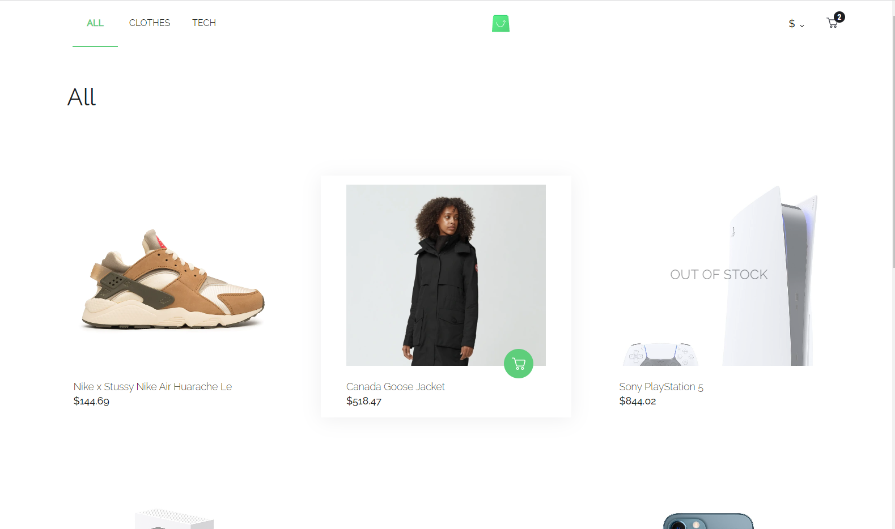
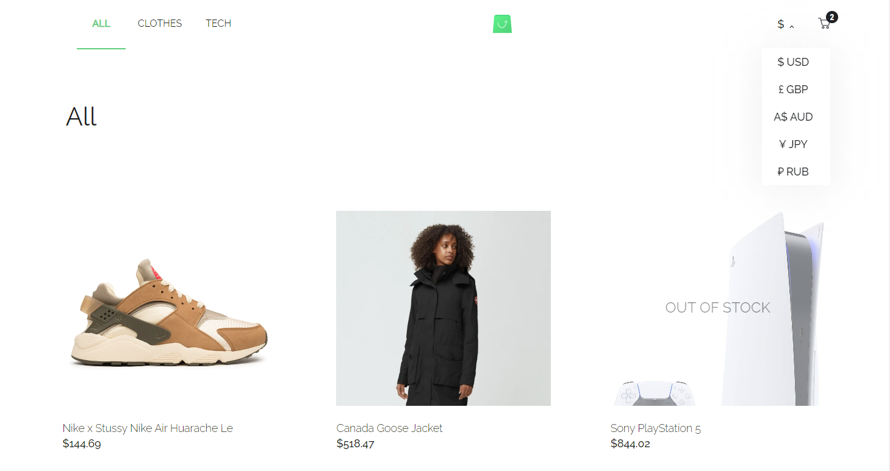
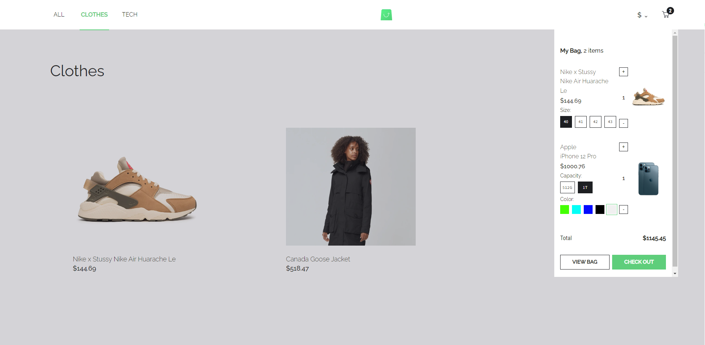
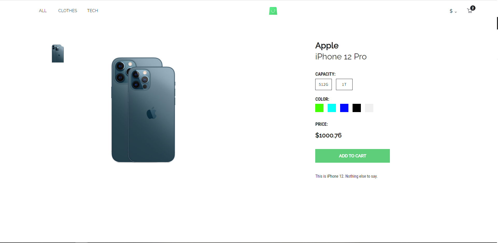
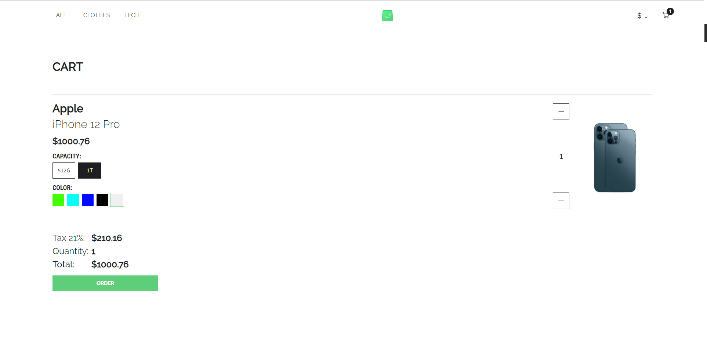
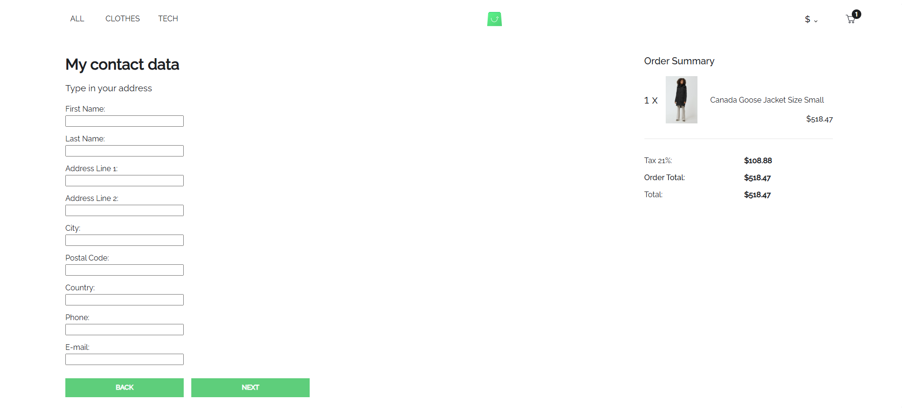
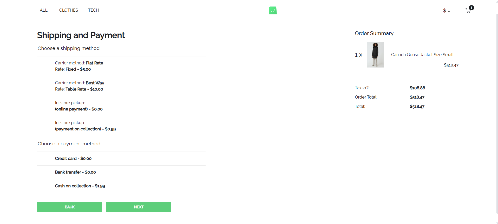

# Minimalistic-storefront

> A mock-up page of an imaginary online shop, fetching data from the GraphQL endpoint, with user accounts served by its own [backend](https://github.com/noszczykmichal/minimalistic-storefront-be).  
> You can check live demo [_here_](https://minimalistic-storefront.web.app/).

## Table of Contents

- [General Info](#general-information)
- [Backend](#backend)
- [Technologies Used](#technologies-used)
- [Features](#features)
- [Setup](#setup)
- [Acknowledgements](#acknowledgements)
- [Contact](#contact)

## General Information

- As the name suggests, it is an imaginary online shop, fetching data from the GraphQL endpoint.
- It consists of four main pages:
  - PLP (product listing page)
  - PDP (product description page)
  - Cart page
  - Checkout (shipping address, payment and delivery)
- Users can sign up, log in and log out. Accounts and sessions are handled by the [backend](#backend).
- More info on the project and screenshots can be found in [Features](#features).

## Backend

The REST API for user accounts and authentication lives in a separate repository: **[noszczykmichal/minimalistic-storefront-be](https://github.com/noszczykmichal/minimalistic-storefront-be)** (NestJS, Prisma, PostgreSQL). The product catalog still comes from the GraphQL endpoint.

- The app calls the API through relative `/api/...` paths (`VITE_API_URL=/api`), so the browser always talks to its own origin and the httpOnly `__session` cookie works without cross-site settings.
- **Locally**, the Vite dev server proxies `/api` to the backend at `http://localhost:8000` (see `vite.config.ts`).
- **In production**, Firebase Hosting rewrites `/api/**` to the Cloud Run service `storefront-api` in `europe-west1` (see `firebase.json`).

## Technologies Used

- [React](https://react.dev/), [React Router](https://reactrouter.com/), [TypeScript](https://www.typescriptlang.org/)
- [Vite](https://vite.dev/) (build tool), [pnpm](https://pnpm.io/) (package manager)
- [Apollo Client](https://www.apollographql.com/docs/react/) (GraphQL), [Axios](https://axios-http.com/) (REST API)
- [Redux Toolkit](https://redux-toolkit.js.org/) + [Redux Persist](https://github.com/rt2zz/redux-persist)
- Forms: [React Hook Form](https://react-hook-form.com/) + [Zod](https://zod.dev/) (validation)
- Testing: [Vitest](https://vitest.dev/), [React Testing Library](https://testing-library.com/docs/react-testing-library/intro/)
- Code Quality: [ESLint](https://eslint.org/), [Prettier](https://prettier.io/)
- CI/CD: [GitHub Actions](https://docs.github.com/en/actions), [Firebase Hosting](https://firebase.google.com/docs/hosting)
- AI-assisted development: [Claude Code](https://docs.claude.com/en/docs/claude-code/overview)
- Additional Tools: [React Transition Group](https://reactcommunity.org/react-transition-group/), [Interweave](https://interweave.dev/)

## Features

- Browse our store to choose from a vast variety of products - whether you're into tech or clothes, you can be sure to find something that catches your eye.
  
- Easily switch between a range of accepted currencies.
  
- Check what's in your cart with one click.
  
- Visit a product page to learn more about the product and configure it to your needs.
  
- Proceed to the cart to see a summary of your current order.
  
- Fill in your shipping address.
  
- Choose your preferred payment and delivery method.
  

## Setup

To run this project locally:

1. Clone this repository

```bash
git clone https://github.com/noszczykmichal/minimalistic-storefront
```

2. Go into the repository

```bash
cd minimalistic-storefront
```

3. Install dependencies

```bash
pnpm install
```

4. Run the app

```bash
pnpm dev
```

The shop opens at `http://localhost:3000`. Browsing and checkout work on their own. Sign-up and login also need the [backend](https://github.com/noszczykmichal/minimalistic-storefront-be) running on `http://localhost:8000`. Follow the setup steps in its README, then start it with `pnpm start:dev`.

## Acknowledgements

- Design and endpoint by [Scandiweb](https://github.com/scandiweb). The repo of the endpoint can be found [here](https://github.com/scandiweb/junior-react-endpoint).

## Contact

Built by [@noszczykmichal](https://michalnoszczyk.com/) - feel free to contact me!
